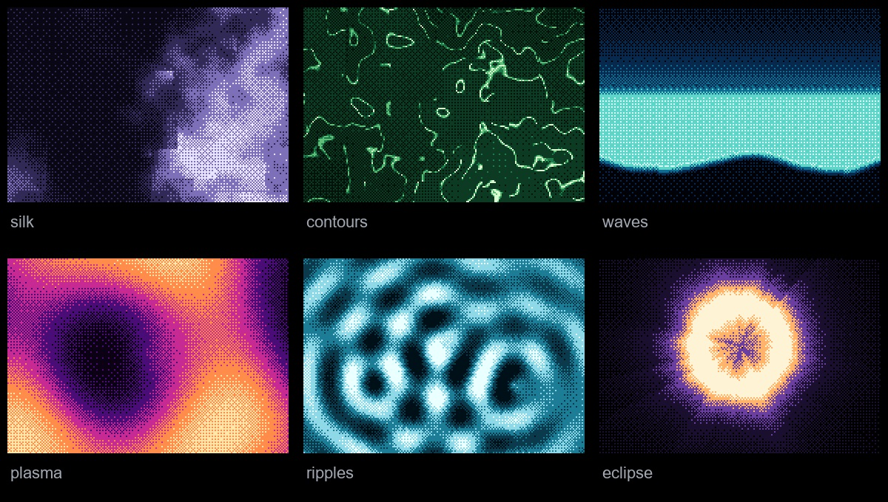

<div align="center">


# astro-dither

Animated dither backgrounds, gradients and image effects. Plain Astro components. No React.

[](https://github.com/screen-gd/astro-dither/actions/workflows/ci.yml)
[](LICENSE)

[Website](https://astro-dither.vercel.app) · [Docs](https://astro-dither.vercel.app/docs) · [Examples](https://astro-dither.vercel.app/examples)

</div>


Six components for decorative backgrounds and image effects. `Dither` and `DitherImage` wrap [Paper Shaders](https://shaders.paper.design); the other four use the package's own ordered-dither engine.

## Features

- **No React.** Plain Astro components and browser custom elements. No `client:*` directives.
- **19 effects** in one registry: aurora, waves, plasma, silk, smoke, contours, ripples, metaballs, tunnel, retro-grid, starfield, eclipse, globe, gradient, glow, mesh, beams, noise, rise.
- **Image dithering** that keeps the real `img` and its alt text in the tree.
- **One shared WebGL context** for the ordered-dither surfaces on a page. Work still scales with the number and size of visible surfaces.
- **Pauses itself** offscreen and in hidden tabs. Respects `prefers-reduced-motion`.
- **Typed props** per effect. Your editor lists only the settings an effect has.
- **Copy-source CLI** for projects that want the code in their own repo.

## Install

```sh
pnpm add astro-dither
```

```sh
npm i astro-dither
```

```sh
bun add astro-dither
```

## Quick start

```astro
---
import { DitherAurora } from "astro-dither";
---

<section style="height: 100svh">
  <DitherAurora />
</section>
```

Any of the 19 registry effects works the same way:

```astro
---
import { DitherEffect } from "astro-dither";
---

<section style="height: 400px">
  <DitherEffect effect="plasma" />
</section>
```

## Components

| Component | What it does | Docs |
| --- | --- | --- |
| `Dither` | Paper's animated dither shapes: sphere, warp, wave, ripple, swirl, dots. | [API](https://github.com/screen-gd/astro-dither/tree/main/packages/astro-dither#dither) |
| `DitherImage` | Ordered dithering over any image. Keeps the `img` and its alt. | [API](https://github.com/screen-gd/astro-dither/tree/main/packages/astro-dither#ditherimage) |
| `DitherGradient` | Linear, radial, conic or wave gradients. | [API](https://github.com/screen-gd/astro-dither/tree/main/packages/astro-dither#wrappers) |
| `DitherAurora` | The aurora effect with all its knobs. | [API](https://github.com/screen-gd/astro-dither/tree/main/packages/astro-dither#wrappers) |
| `DitherEffect` | Any of the 19 effects below, animated or still. | [API](https://github.com/screen-gd/astro-dither/tree/main/packages/astro-dither#dithereffect) |
| `DitherGlobe` | A spinning, lit globe dithered from a land mask. | [API](https://github.com/screen-gd/astro-dither/tree/main/packages/astro-dither#wrappers) |

## Effects



| Group | Effects |
| --- | --- |
| Gradients and glows | `gradient`, `glow`, `mesh`, `beams`, `rise` |
| Textures | `noise`, `plasma`, `silk`, `smoke`, `waves` |
| Patterns | `contours`, `ripples`, `metaballs`, `tunnel`, `retro-grid` |
| Scenes | `aurora`, `starfield`, `eclipse`, `globe` |

`DitherEffect` takes `params` (the selected effect's typed settings), `palette` (2 to 8 colours), `cell`, `matrix` (Bayer 2x2, 4x4, 8x8 or noise), `speed`, `levels`, `stillTime`, `bloom`, `bloomRadius`, and `class`. See the [package README](packages/astro-dither/README.md#dithereffect) for defaults and parameter tables.

## Copy the source

Prefer owning the code instead of a dependency? Copy the components into your project:

```sh
npx astro-dither add aurora
```

- `npx astro-dither add aurora image globe` copies several at once.
- `--dir src/components/ui` changes the target directory (default `src/components/dither`).
- `--force` overwrites existing files; without it, changed files are skipped.
- `npx astro-dither list` shows all six components.
- `all` copies everything, including the engine.

Relative imports and assets (like the globe's land mask) are followed automatically.

## How it works

The four ordered-dither components render `<dither-surface>` with settings serialised at build time. A custom element draws each GLSL field through a threshold matrix into its palette, using one shared WebGL2 context. The renderer draws one pixel per dither cell and scales the result up. Optional bloom adds a blurred copy of the frame.

`Dither` renders `<dither-canvas>` and mounts Paper's animated shape shader. `DitherImage` mounts Paper's image filter in its own context and leaves the original `img` in place for alt text and the no-JavaScript fallback. Every element dispatches a bubbling `dither:ready` event after its first frame.

## Browser support and accessibility

- Requires WebGL2. Where a surface cannot start it stays blank; `DitherImage` falls back to the plain `img`.
- Backgrounds render `aria-hidden` so screen readers skip them.
- `prefers-reduced-motion` stops animation. Ordered surfaces use `stillTime`; Paper shapes use `frame`.
- IntersectionObserver and `visibilitychange` pause rendering offscreen and in hidden tabs.

## Repository layout

```
packages/astro-dither/   the npm package (components, engine, CLI, tests)
site/                  the Astro site on astro-dither.vercel.app
scripts/               favicon, land-mask and social/README image generators
assets/                icon and README images
.github/               CI workflow, issue templates, dependabot
```

## Development

Requires Node 22.23.4 or newer (`.nvmrc`) and pnpm (`packageManager` pins 12.11.2).

```sh
pnpm install     # install the workspace
pnpm dev         # site at http://localhost:4321
pnpm test        # vitest on the package
pnpm check       # astro check on package and site
pnpm build       # build the site into site/dist
node scripts/favicon.mjs   # regenerate favicons into site/public
```

README and social artwork is rendered directly from the current GLSL, without a browser. It is optional for normal development. With Python 3, a working OpenGL 3.3 context and Node 22.23.4+:

```sh
python -m pip install -r scripts/requirements-artwork.txt
python scripts/social.py
```

This updates `site/public/social.png`, `assets/readme/hero.jpg`, and `assets/readme/effects.jpg`. On systems without Arial or DejaVu Sans, set `SOCIAL_FONT` and `SOCIAL_FONT_BOLD` to font file paths.

## Deploying the site

The site deploys to Vercel from the repo root. Import the GitHub repo and Vercel reads `vercel.json`: framework `astro`, install `pnpm install --frozen-lockfile`, build `pnpm build`, output `site/dist`. Nothing else to set. The production URL is picked up automatically for absolute OG tags; set `SITE_URL` only if you need to override it.

## Releasing

See [RELEASING.md](RELEASING.md) for the first release, package checks and later updates. Publishing is manual; the CI workflow only validates and packs the library.

## Contributing

See [CONTRIBUTING.md](CONTRIBUTING.md). Bug reports and feature requests go through [GitHub issues](https://github.com/screen-gd/astro-dither/issues); security reports through [private vulnerability reporting](https://github.com/screen-gd/astro-dither/security).

## Credits

- [Paper Shaders](https://shaders.paper.design) for the shader shapes and the image filter.
- [dithercn](https://dithercn.vercel.app) by Leo, which this project is based on.
- [Starwind UI](https://starwind.dev), [Cult UI](https://www.cult-ui.com) and [Kibo UI](https://www.kibo-ui.com) for the site's buttons and snippets.

## Licence

[MIT](LICENSE), Screen 2026.
